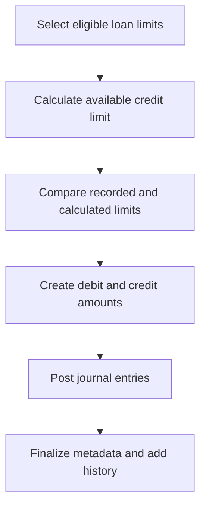
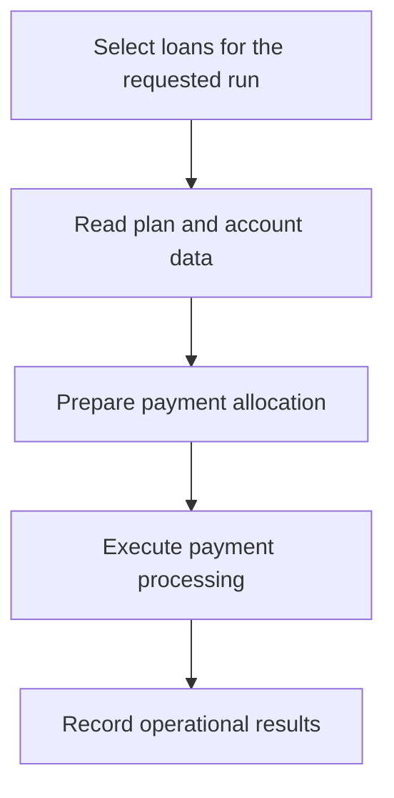
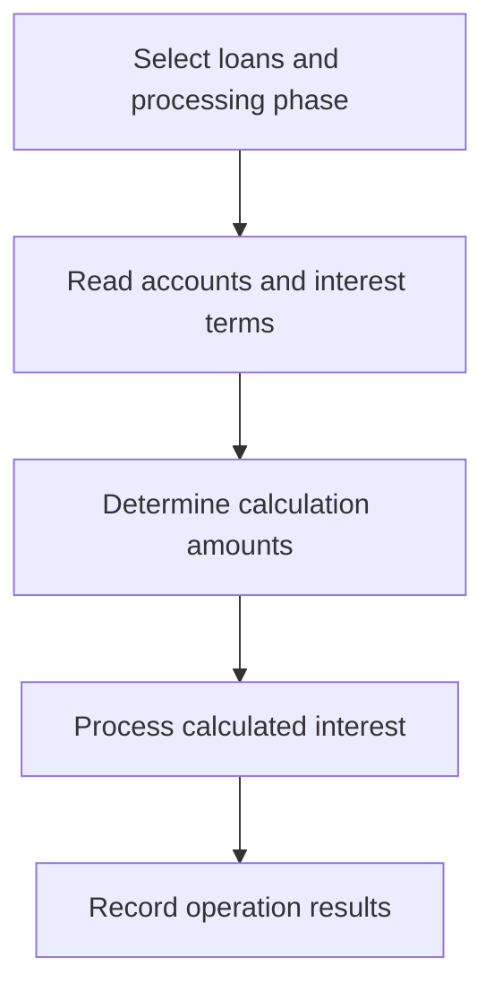
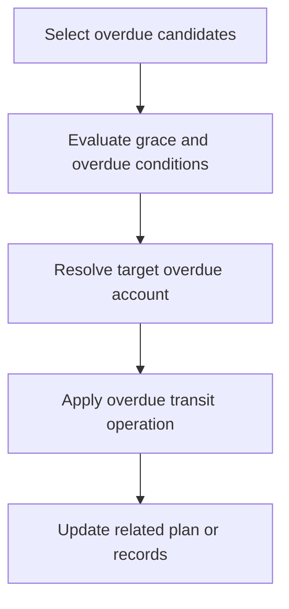

# LOAN_API — Workflows

[← Back to Overview](README.md) · [API Reference](api.md) · [Workflows](workflows.md) · [Data Model](data-model.md) · [Dependencies](dependencies.md) · [Error Handling](error-handling.md)

## Workflow index

- [Limit evaluation](#workflow-limit-evaluation)
- [Automatic payment](#workflow-automatic-payment)
- [Interest calculation](#workflow-interest-calculation)
- [Overdue transit](#workflow-overdue-transit)

### Limit evaluation

**Purpose:** Reconciles calculated limits with recorded limit accounts.

**Trigger / entry point:** [evaluate_limit_amount](api.md#evaluate-limit-amount)

**Key business rules**

- Credit-line or card loan eligibility and active status are checked.
- Zero calculated limits apply to category 667 or elapsed loan end date.

**Result / side effects:** Processing may affect loan financial records or their history; see [Data Model](data-model.md) and [Error Handling](error-handling.md).

### Automatic payment

**Purpose:** Processes payments for loans eligible in the selected run.

**Trigger / entry point:** [do_Auto_Payment](api.md#do-auto-payment)

**Key business rules**

- Processing is sensitive to the selected EOD/SOD phase and requested loan/range.

**Result / side effects:** Processing may affect loan financial records or their history; see [Data Model](data-model.md) and [Error Handling](error-handling.md).

### Interest calculation

**Purpose:** Calculates loan interest for an eligible processing date.

**Trigger / entry point:** [do_int_calculation](api.md#do-int-calculation)

**Key business rules**

- Inputs include processing date, loan identifier/range, and EOD/SOD phase.

**Result / side effects:** Processing may affect loan financial records or their history; see [Data Model](data-model.md) and [Error Handling](error-handling.md).

### Overdue transit

**Purpose:** Applies overdue transition processing to qualifying loan accounts.

**Trigger / entry point:** [do_overdue_transit_operation](api.md#do-overdue-transit-operation)

**Key business rules**

- Overdue eligibility depends on configured account categories and dates.

**Result / side effects:** Processing may affect loan financial records or their history; see [Data Model](data-model.md) and [Error Handling](error-handling.md).

